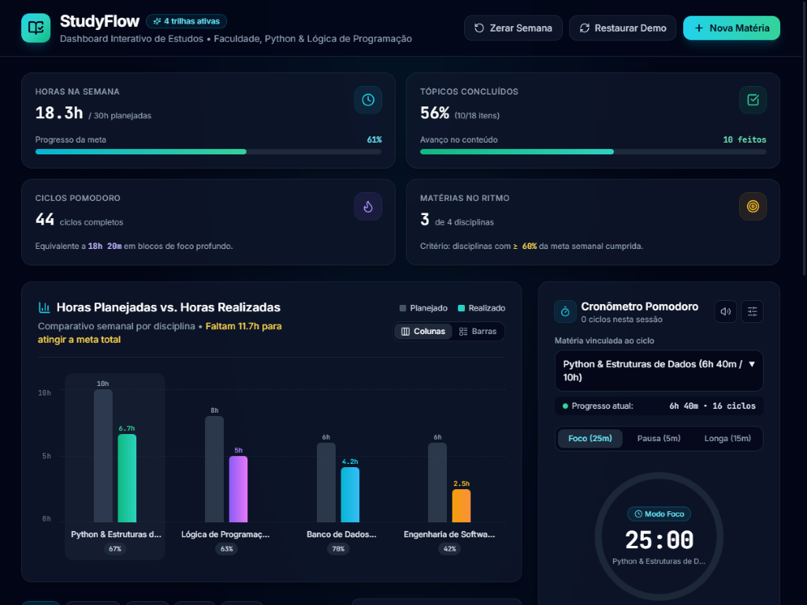
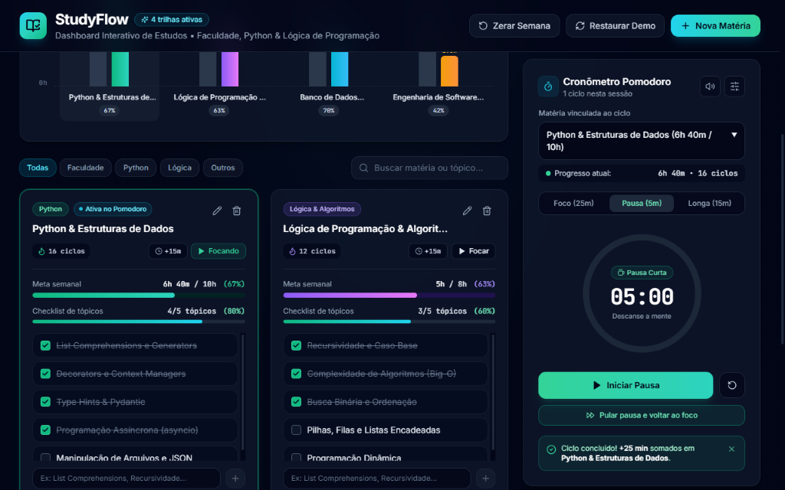
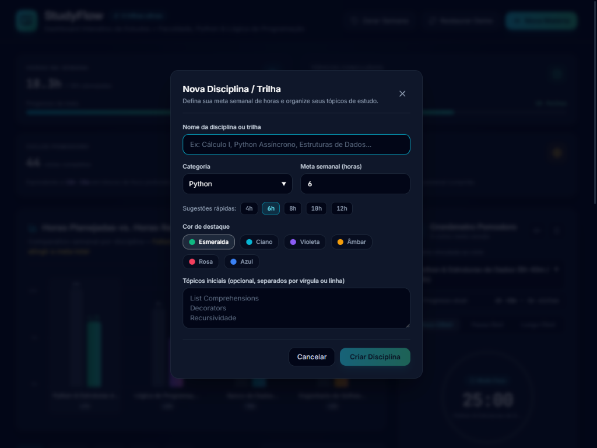

# StudyFlow — Dashboard Interativo de Estudos

Dashboard interativo de produtividade e acompanhamento de estudos para disciplinas da faculdade, estudos de Python e lógica de programação, construído em Dark Mode moderno.

## Preview da Interface

### Visão Geral e Comparativo Semanal


### Trilhas de Estudo, Checklists e Pomodoro Integrado


### Cadastro de Disciplina / Trilha


## Funcionalidades

- **Gestão de Trilhas e Matérias:** Cadastro e edição de disciplinas com categoria (`Faculdade`, `Python`, `Lógica & Algoritmos`, `Outros`), cor de destaque e meta semanal de horas.
- **Cronômetro Pomodoro Integrado:** Timer funcional (`25 / 5 / 15 min` personalizáveis) vinculado a uma matéria específica. Ao concluir um ciclo de foco, os minutos e o ciclo são somados automaticamente ao progresso da disciplina.
- **Visualização de Progresso:** Barras de progresso por matéria e gráfico comparativo semanal (**Horas Planejadas vs. Horas Realizadas**) com alternância entre colunas verticais e barras horizontais.
- **Checklist de Tópicos:** Sub-tarefas dentro de cada matéria com cálculo automático da porcentagem de conclusão e adição/remoção rápida.
- **Persistência Desacoplada:** Camada de serviço baseada no contrato `IStudyStorageService` usando `localStorage`, estruturada para troca futura por uma API REST.

## Stack & Arquitetura

- **React 18** + **TypeScript** + **Tailwind CSS** + **Lucide Icons** + **Vite**
- `src/types/study.ts`: Definição dos contratos e entidades (`Subject`, `TopicItem`, `StudySession`, `DashboardMetrics`, `IStudyStorageService`).
- `src/services/studyStorageService.ts`: Implementação `LocalStorageStudyService` com dados iniciais de exemplo.
- `src/hooks/useStudyTracker.ts` e `src/hooks/usePomodoro.ts`: Custom Hooks para gerenciamento de estado e timer.
- `src/components/`: Componentes visuais puramente declarativos (`Header`, `KpiOverview`, `WeeklyComparisonChart`, `SubjectCard`, `PomodoroTimer`, `SubjectModal`).

## Como Executar

```bash
# Instalar dependências
npm install

# Rodar servidor de desenvolvimento
npm run dev

# Gerar build de produção
npm run build
```
